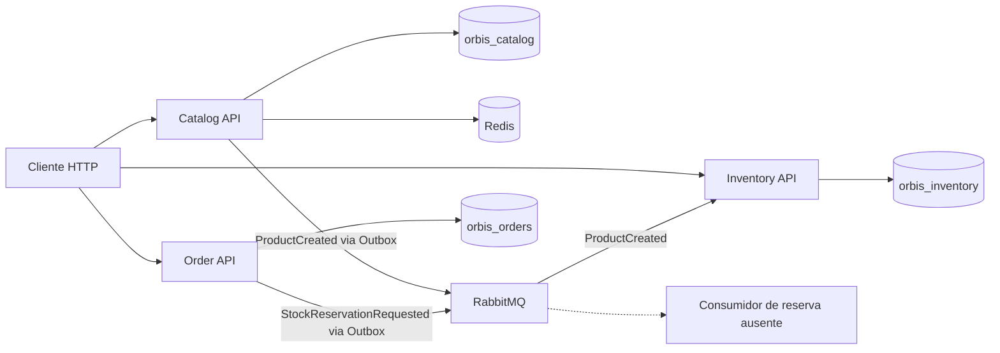

# Orbis Commerce

Backend de comércio eletrônico desenvolvido em C# e .NET 10 para estudar APIs, persistência relacional e comunicação assíncrona entre microsserviços. O projeto organiza catálogo, estoque e pedidos em serviços separados, com contratos de eventos compartilhados.

Projeto educacional e de portfólio de desenvolvimento backend .NET. Não representa uma plataforma de comércio pronta para produção.

## Estado atual

O código implementa cadastro e consulta de produtos, operações de estoque e criação de pedidos. A integração `ProductCreated` cria o estoque inicial de forma assíncrona. O fluxo de pedidos está **parcialmente implementado**: publica `StockReservationRequested`, mas não existe consumidor desse evento nem processamento de confirmação/rejeição. Os pedidos permanecem em `PendingReservation` pelos fluxos disponíveis.

A inspeção também encontrou testes de Inventory com referências a membros de enum inexistentes, duas consultas de existência com limitações no Catalog e uma divergência de capitalização no Dockerfile de Inventory. Consulte as [pendências](docs/ROADMAP.md) antes de executar a solução completa. Esta documentação não declara build, testes ou deploy aprovados.

## Funcionalidades implementadas

- Catalog: criar produtos, consultar por identificador, listar e contar; validação de nome, SKU e preço; unicidade de SKU no PostgreSQL.
- Cache da consulta de produto por identificador no Redis, com expiração de cinco minutos e consulta ao banco em determinadas falhas de conexão/timeout.
- Publicação de `ProductCreated` com Bus Outbox; consumidor em Inventory cria estoque com saldo zero.
- Inventory: criar, listar, consultar e adicionar estoque; reservar por pedido/produto e liberar reservas, com transações e atualização condicional de saldo.
- Order: criar pedido com um produto e quantidade, consultar por identificador e publicar solicitação de reserva via Bus Outbox.
- Liveness em cada API; OpenAPI e Scalar apenas em `Development`.

## Stack verificada

| Componente | Uso no repositório |
| --- | --- |
| C# / .NET 10 | Todos os projetos usam `net10.0`; APIs ASP.NET Core Minimal APIs |
| Entity Framework Core / Npgsql | PostgreSQL; Design 10.0.4 e provider 10.0.3 em Catalog/Inventory; referências `10.*` em Order |
| PostgreSQL | Imagem `postgres:17` no Compose; `postgres:17-alpine` nos Testcontainers |
| MassTransit / RabbitMQ | MassTransit 8.5.12 em Catalog/Inventory e 8.5.2 em Order; broker `rabbitmq:4-management` |
| Redis | `redis:7-alpine`; `Microsoft.Extensions.Caching.StackExchangeRedis` 10.0.14 |
| OpenAPI / Scalar | OpenAPI 10.0.14; Scalar 2.18.7, 2.19.0 e 2.21.0, respectivamente |
| Testes | xUnit 2.9.3, Moq 4.20.72, Testcontainers.PostgreSql 4.16.0, SQLite em memória; Coverlet nos testes de Catalog |
| Containers | Dockerfiles multi-stage com SDK/runtime .NET 10 e Docker Compose |

As versões acima são declarações dos projetos e do Compose, não uma certificação de compatibilidade ou atualização.

## Arquitetura e responsabilidades



| Serviço | Responsabilidade | Banco | Porta Compose / perfil local |
| --- | --- | --- | --- |
| Catalog | Dados de produto e cache de leitura | `orbis_catalog` | 5080 / 5141 |
| Inventory | Saldo físico, saldo reservado e histórico de reservas | `orbis_inventory` | 5081 / 5227 |
| Order | Pedido de um produto e solicitação assíncrona de reserva | `orbis_orders` | 5082 / 5038 |

Os bancos são separados logicamente, mas compartilham uma instância PostgreSQL e um usuário no Compose. Não há chamadas HTTP entre os serviços no código atual. Veja [arquitetura e trade-offs](docs/ARCHITECTURE.md).

## Estrutura

```text
OrbisCommerce.slnx
compose.yaml
.env.example
src/
  .dockerignore
  BuildingBlocks/Orbis.Contracts/Events/
  Services/
    Catalog/Orbis.Catalog.Api/
      Application/ Contracts/ Data/ Domain/ Endpoints/
      Migrations/ Properties/ Repositories/
      Program.cs, Dockerfile, appsettings*.json
    Inventory/Orbis.Inventory.Api/
      Application/ Consumers/ Contracts/ Data/ Domain/
      Endpoints/ Migrations/ Properties/
      Program.cs, dockerfile, appsettings*.json
    Order/Orbis.Order.Api/
      Application/ Contracts/ Data/ Domain/ Endpoints/
      Migrations/ Properties/
      Program.cs, Dockerfile, appsettings*.json
tests/
  Orbis.Catalog.UnitTests/
  Orbis.Catalog.IntegrationTests/
  Orbis.Inventory.IntegrationTests/
docs/
  ARCHITECTURE.md
  API.md
  DEVELOPMENT.md
  TESTING.md
  ROADMAP.md
```

A pasta local `infra/` está vazia na inspeção e não contém provisionamento versionado. As APIs também contêm arquivos `.http`, ainda com a rota de template `/weatherforecast`, que não está implementada.

## Pré-requisitos e configuração

Use SDK .NET 10, PowerShell, Git e Docker com containers Linux e Compose v2. A CLI `dotnet-ef` 10.x é necessária para migrations. Testes unitários de Catalog não dependem de Docker; os testes PostgreSQL dependem dele.

Na raiz, crie `.env` a partir de [.env.example](.env.example) **somente se ainda não existir** e substitua os valores fictícios:

```powershell
if (-not (Test-Path .env)) { Copy-Item .env.example .env }
docker compose up -d --wait postgres redis rabbitmq
```

O Compose exige `POSTGRES_PASSWORD` e `RABBITMQ_PASSWORD`. Ele monta as variáveis `ConnectionStrings__CatalogDb`, `ConnectionStrings__InventoryDb`, `ConnectionStrings__OrderDb`, `ConnectionStrings__Redis` e `RabbitMq__Host`, `RabbitMq__Username`, `RabbitMq__Password` dos containers. O `.env` não é carregado automaticamente por `dotnet run`.

Siga [DEVELOPMENT.md](docs/DEVELOPMENT.md) para definir essas variáveis no PowerShell, restaurar dependências e aplicar as migrations dos três projetos. A aplicação não executa migrations automaticamente; o Compose inicializa apenas `orbis_catalog` em um volume PostgreSQL novo. Os outros bancos e suas tabelas precisam ser preparados.

## Execução local e Docker Compose

Após configurar o ambiente e aplicar migrations, execute cada comando em um terminal configurado:

```powershell
dotnet run --project src/Services/Catalog/Orbis.Catalog.Api --launch-profile http
dotnet run --project src/Services/Inventory/Orbis.Inventory.Api --launch-profile http
dotnet run --project src/Services/Order/Orbis.Order.Api --launch-profile http
```

Para executar as APIs em containers:

```powershell
docker compose up -d --build
docker compose ps
```

**Pendência de portabilidade:** o Compose aponta para `Services/Inventory/Orbis.Inventory.Api/Dockerfile`, mas o arquivo versionado se chama `dockerfile`. Em ambientes sensíveis a maiúsculas/minúsculas, o build pode falhar. O [guia de desenvolvimento](docs/DEVELOPMENT.md) apresenta um build explícito sem modificar o código.

## Exemplo HTTP

Exemplo para Catalog via Compose, após a preparação dos bancos:

```http
POST http://localhost:5080/api/products/
Content-Type: application/json

{
  "name": "Teclado mecânico",
  "sku": "ORB-TEC-001",
  "price": 249.90
}
```

A resposta de criação é `201 Created`, com `id`, `name`, `sku`, `price` e `createdAt`, além do cabeçalho `Location`. Para consultar:

```http
GET http://localhost:5080/api/products/
```

O estoque correspondente surge de forma eventual, com quantidade zero. Consulte [API.md](docs/API.md) para payloads, respostas, reposição, reserva, liberação e pedidos. Os exemplos são derivados do código; não são capturas de uma execução.

## Testes

```powershell
dotnet test tests/Orbis.Catalog.UnitTests/Orbis.Catalog.UnitTests.csproj
dotnet test OrbisCommerce.slnx --filter "Category!=Docker"
dotnet test OrbisCommerce.slnx --filter "Category=Docker"
```

Os comandos da solução estão sujeitos ao bloqueio de compilação identificado nos testes de Inventory: referências a `invalidQuantity` e `insufficientStock`, enquanto o enum atual usa `InvalidQuantity` e `InsufficientStock`. Filtrar testes não evita compilar os projetos. A sobrecarga antiga também retorna `InsufficientStock` para quantidade inválida. Veja [TESTING.md](docs/TESTING.md) para escopo, lacunas e comandos por projeto.

## Padrões e limitações

Há organização por serviço e por responsabilidade, injeção de dependência, Repository no Catalog, EF Core, cache-aside, eventos de integração, Transactional Outbox e controles de idempotência no estoque. As camadas estão em pastas dentro das APIs; não há uma separação completa em assemblies de domínio/aplicação/infraestrutura.

Ainda não há autenticação/autorização, frontend, checkout completo, pagamento, pipeline CI/CD, tracing distribuído ou configuração de deploy. O liveness não verifica banco, cache ou broker. Não há licença definida no repositório inspecionado; nenhuma licença foi presumida.

## Documentação

- [Arquitetura](docs/ARCHITECTURE.md)
- [Referência da API](docs/API.md)
- [Ambiente e desenvolvimento](docs/DEVELOPMENT.md)
- [Testes](docs/TESTING.md)
- [Roadmap e prioridades de publicação](docs/ROADMAP.md)
- [Segurança](SECURITY.md)
- [Contribuição](CONTRIBUTING.md)
