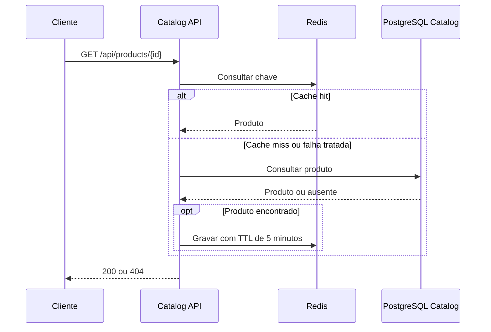
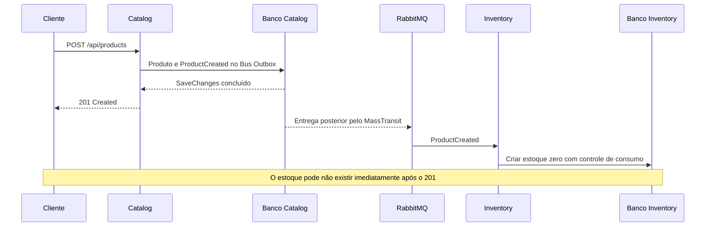
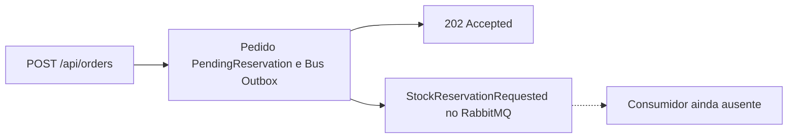

# Arquitetura

[Voltar ao README](../README.md)

Este documento descreve o código inspecionado, incluindo os pontos em que o fluxo ainda está incompleto. Não pressupõe execução em produção.

## Limites dos serviços

| Serviço | Dados próprios | Responsabilidades e limites |
| --- | --- | --- |
| Catalog | `Product` | Nome, SKU, preço e data de criação; não controla estoque |
| Inventory | `StockItem`, `StockReservation` | Quantidade total, reservada e disponível; reservas por par pedido/produto; não valida a existência de pedidos no Order |
| Order | `Order` | Um produto e quantidade por pedido; estado inicial `PendingReservation`; não calcula total nem registra pagamento |
| Orbis.Contracts | Records de eventos | Compartilha `ProductCreated` e `StockReservationRequested`; não contém entidades EF |

Fontes: [Catalog](../src/Services/Catalog/Orbis.Catalog.Api), [Inventory](../src/Services/Inventory/Orbis.Inventory.Api), [Order](../src/Services/Order/Orbis.Order.Api) e [contratos](../src/BuildingBlocks/Orbis.Contracts/Events).

Cada API contém pastas de aplicação, domínio, contratos, endpoints e dados. Catalog encapsula persistência em `IProductRepository`; Inventory usa `DbContext` nos endpoints e no serviço de reservas; Order usa `DbContext` no serviço de aplicação. Não há MediatR, API Gateway, saga ou event sourcing implementado.

## Persistência e ownership

| Banco no Compose | Tabelas de negócio | Restrições relevantes |
| --- | --- | --- |
| `orbis_catalog` | `products` | SKU único; nome até 150 caracteres, SKU até 60; preço `numeric(18,2)` |
| `orbis_inventory` | `stock_items`, `stock_reservations` | Produto único no estoque; par `OrderId`/`ProductId` único na reserva; quantidades de estoque não negativas e reserva não superior ao total; quantidade da reserva positiva |
| `orbis_orders` | `orders` | Quantidade positiva; estado persistido como inteiro |

Todos os contextos mapeiam `InboxState`, `OutboxMessage` e `OutboxState`. A presença das tabelas não significa que todos os serviços tenham consumidores. Catalog e Order usam Bus Outbox; Inventory configura Consumer Outbox para o consumidor registrado.

O [Compose](../compose.yaml) usa uma instância PostgreSQL e o mesmo usuário para os três bancos. Isso simplifica o ambiente local, mas não oferece isolamento de credenciais ou de recursos por serviço. Não existem foreign keys entre bancos. Inventory aceita criação manual de estoque para um GUID sem consultar Catalog; Order aceita produto não vazio sem verificar sua existência ou disponibilidade.

## Fluxos síncronos

Os clientes chamam cada API diretamente. Não há cliente HTTP de comunicação entre microsserviços.

Na leitura de produto por ID, `CachedProductReader` procura a chave `product:{id}`, com prefixo de instância `orbis:catalog:`. Em cache miss, consulta Catalog e grava o resultado com expiração absoluta de cinco minutos. Produtos ausentes não são armazenados. A listagem e a contagem não usam Redis.

`RedisConnectionException`, `RedisTimeoutException` e `TimeoutException` na leitura/gravação têm fallback para a origem. Isso não cobre qualquer exceção: JSON inválido e cancelamento não são tratados como indisponibilidade de cache. Existe método de invalidação, mas nenhum endpoint de atualização/exclusão de produto o utiliza.

## Eventos e consistência eventual

| Evento | Campos | Publicador | Consumidor existente |
| --- | --- | --- | --- |
| `ProductCreated` | `EventId`, `ProductId`, `Sku`, `OccurredAt` | Catalog | `ProductCreatedConsumer` em Inventory |
| `StockReservationRequested` | `EventId`, `OrderId`, `ProductId`, `Quantity`, `OccurredAt` | Order | Nenhum |

O serviço publica pelo `IPublishEndpoint` antes de `SaveChangesAsync`; o Bus Outbox configurado associa a mensagem à unidade de persistência. A entrega ao broker ocorre posteriormente. Isso reduz o problema de gravar a entidade e perder o evento entre duas operações independentes, mas adiciona tabelas, processamento em segundo plano e atraso de propagação. Não é uma transação distribuída entre os bancos.

Inventory registra apenas `ProductCreatedConsumer`, aplica retries de 1, 2 e 3 segundos e `UseEntityFrameworkOutbox<InventoryDbContext>`. O consumidor verifica existência por `ProductId`; há índice único e tratamento específico de violação desse índice. `EventId` está no contrato, mas não é usado explicitamente como chave de deduplicação da aplicação. O controle de inbox do MassTransit e a unicidade de negócio são mecanismos distintos; não se promete entrega exatamente uma vez de ponta a ponta.

Para a demonstração, inicie Inventory antes de criar produtos, permitindo configurar a topologia de consumo. Não há rotina própria de reconciliação de produtos históricos com estoques ausentes.

## Reservas e idempotência

A [reserva HTTP](../src/Services/Inventory/Orbis.Inventory.Api/Application/StockReservationService.cs) usa `OrderId`, `ProductId` e quantidade:

1. Valida identificadores e quantidade positiva.
2. Consulta reserva existente para o par pedido/produto.
3. Em transação, incrementa `ReservedQuantity` com `ExecuteUpdateAsync` condicionado ao saldo disponível.
4. Persiste `StockReservation` e confirma a transação.
5. Trata conflito de unicidade do par, consultando o registro persistido após rollback.

Uma reserva existente com mesma quantidade e estado `Reserved` retorna `AlreadyReserved`. Quantidade diferente ou reserva já liberada resulta em conflito. A liberação altera `Reserved` para `Released` condicionalmente e reduz o saldo reservado na mesma transação; repetição retorna `AlreadyReleased`.

Esses mecanismos não tornam todas as operações idempotentes: adicionar estoque repetidamente soma novamente; criar pedidos repetidamente gera novos pedidos. Uma corrida pode ainda devolver saldo insuficiente antes de alcançar o tratamento de unicidade. Não há testes atuais que validem todas as intercalações do fluxo por pedido.

A sobrecarga antiga `ReserveAsync(productId, quantity)` ainda existe: apenas incrementa o saldo reservado, sem criar `StockReservation`. Os testes existentes de reserva exercitam essa sobrecarga, enquanto o endpoint usa a versão com `OrderId`.

## Fluxo de pedidos incompleto

`ConfirmReservation` e `RejectReservation` existem na entidade, mas não são chamados pelos fluxos da aplicação. Não há eventos de resultado, consumidores de retorno, cancelamento automático ou compensação entre Order e Inventory. Fazer reserva manual via HTTP não altera o pedido.

## Decisões e trade-offs observáveis

- Bancos por serviço favorecem ownership, mas exigem consistência eventual e preparação de três esquemas.
- Contratos compartilhados simplificam a integração tipada, mas exigem coordenação de evolução e compatibilidade.
- Atualizações condicionais no banco reduzem a janela de disputa por saldo; a validação concorrente precisa usar PostgreSQL real.
- Redis reduz consultas repetidas por ID, com possibilidade de dados temporariamente antigos e tratamento de falhas limitado.
- Separação em pastas mantém o exemplo acessível, sem impor isolamento de dependências entre assemblies.
- Logs e liveness são básicos; não há métricas, tracing distribuído, readiness ou monitoramento de filas/outbox configurados.
- Versões MassTransit diferem entre serviços; Order usa versões EF/Npgsql flutuantes. Reprodutibilidade e alinhamento de dependências permanecem pendentes.

Próximos passos estão no [roadmap](ROADMAP.md).
